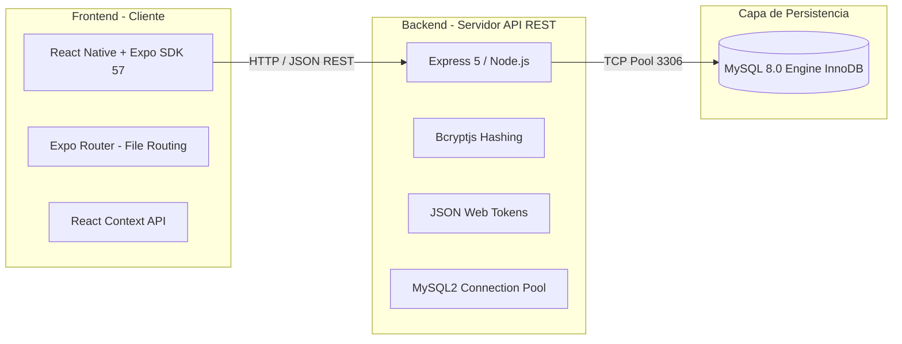
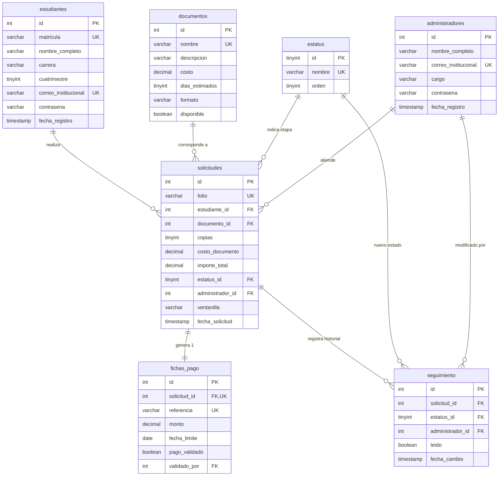

# 📄 PoliDoc — Informe Técnico y Arquitectura del Sistema

> **Sistema Integral de Gestión y Seguimiento de Trámites y Documentos Académicos**  
> **Fecha de corte:** Octubre 2026 | **Versión:** 1.0.0 | **Estado:** Backend funcional con Autenticación y Frontend base

---

## 📑 Tabla de Contenidos
1. [Resumen Ejecutivo y Propósito del Proyecto](#1-resumen-ejecutivo-y-propósito-del-proyecto)
2. [Stack Tecnológico y Lenguajes Utilizados](#2-stack-tecnológico-y-lenguajes-utilizados)
3. [Arquitectura del Repositorio (Estructura de Carpetas)](#3-arquitectura-del-repositorio-estructura-de-carpetas)
4. [Backend — Desglose y Funcionalidad Archivo por Archivo](#4-backend--desglose-y-funcionalidad-archivo-por-archivo)
5. [Frontend — Desglose y Funcionalidad Archivo por Archivo](#5-frontend--desglose-y-funcionalidad-archivo-por-archivo)
6. [Base de Datos MySQL (Esquema Relacional y Reglas de Negocio)](#6-base-de-datos-mysql-esquema-relacional-y-reglas-de-negocio)
7. [Interconexión y Flujos de Datos (End-to-End)](#7-interconexión-y-flujos-de-datos-end-to-end)
8. [Guía para Explicar el Proyecto a Terceros o Evaluadores](#8-guía-para-explicar-el-proyecto-a-terceros-o-evaluadores)
9. [Guía Rápida de Ejecución Local](#9-guía-rápida-de-ejecución-local)

---

## 1. Resumen Ejecutivo y Propósito del Proyecto

**PoliDoc** es una solución digital concebida para modernizar la ventanilla de Servicios Escolares de una institución educativa de nivel superior.

### La Problemática
Tradicionalmente, los trámites de constancias, kárdex y credenciales implican filas físicas, pagos en ventanilla con recibos de papel, falta de visibilidad del avance del documento y saturación del personal administrativo.

### La Solución
Una plataforma desacoplada (cliente-servidor) donde:
- **El Estudiante:** Puede consultar el catálogo oficial de trámites, solicitarlos con número de copias calculado, recibir una referencia de pago bancario, monitorear el avance en tiempo real (etapas desde revisión hasta entrega) y recibir notificaciones.
- **El Personal Administrativo (Servicios Escolares):** Cuenta con un panel centralizado para auditar solicitudes entrantes, validar pagos, cambiar el estatus operativo del trámite y asignar ventanillas de entrega.

---

## 2. Stack Tecnológico y Lenguajes Utilizados

El proyecto está construido íntegramente en **TypeScript** bajo un modelo de arquitectura limpia y desacoplada:



### Tecnologías en el Servidor (Backend)
- **Node.js (v20+) con TypeScript (v5.7):** Tipado estático estricto para evitar errores en tiempo de ejecución.
- **Express.js (v5):** Framework web minimalista de alto rendimiento para crear la API REST.
- **MySQL 8.0 (Motor InnoDB):** Base de datos relacional con integridad referencial, transacciones ACID y restricciones `CHECK`.
- **mysql2/promise:** Controlador de alto rendimiento que implementa un **Pool de Conexiones** no bloqueante con soporte asíncrono (`async/await`).
- **bcryptjs (v3):** Algoritmo de hashing criptográfico unidireccional con factor de coste (*salt rounds = 12*) para proteger contraseñas.
- **jsonwebtoken (v9):** Generación y validación de tokens de sesión **JWT (HS256)** con expiración programada (8 horas) y almacenamiento seguro del rol (`alumno` o `admin`).
- **ts-node-dev:** Herramienta de compilación y recarga en caliente (*hot-reload*) para desarrollo ágil.
- **dotenv & cors:** Gestión segura de variables de entorno y control de políticas de acceso entre dominios.

### Tecnologías en la Aplicación Cliente (Frontend)
- **React Native (v0.86) + React 19:** Renderizado de interfaces nativas universales para Android, iOS y Web con una sola base de código.
- **Expo (SDK 57):** Ecosistema moderno para empaquetado, pruebas en emuladores y dispositivos físicos mediante Expo Go.
- **Expo Router:** Enrutamiento declarativo basado en sistema de archivos (similar a Next.js), que soporta grupos de rutas protegidas `(alumno)` y `(admin)`.
- **React Context API:** Manejo de estado global reactivo sin dependencias pesadas:
  - `AuthContext`: Sesión del usuario, token JWT y datos de identidad.
  - `AppContext`: Lista de trámites activos, avisos e historial.
- **Safe Area Context:** Adaptabilidad visual para respetar barras de estado, notches e islas dinámicas de smartphones.

---

## 3. Arquitectura del Repositorio (Estructura de Carpetas)

El repositorio se organizó bajo un esquema **Monorepo desacoplado**, donde el código del servidor y el código de la app móvil/web tienen dependencias y ciclos de vida independientes:

```text
polidoc/
├── docs/                             # Documentación técnica del proyecto
│   └── INFORME_PROYECTO.md           # Este informe
│
├── Backend/                          # Servidor de API REST (Node.js + Express)
│   ├── src/
│   │   ├── database/
│   │   │   └── connection.ts         # Pool de conexión a MySQL
│   │   ├── routes/
│   │   │   ├── auth.routes.ts        # Endpoints de login y registro
│   │   │   ├── database.routes.ts    # Verificación de salud de la base de datos
│   │   │   └── test.routes.ts        # Ruta de prueba de conectividad
│   │   └── server.ts                 # Archivo principal de arranque del servidor
│   ├── .env                          # Variables de entorno secretas (ignorado por Git)
│   ├── .env.example                  # Plantilla de variables para el equipo
│   ├── package.json                  # Dependencias del Backend
│   └── tsconfig.json                 # Configuración de TypeScript del Backend
│
├── Frontend/                         # App Universal Móvil y Web (Expo / React Native)
│   ├── assets/                       # Iconos, splash screens y recursos visuales
│   ├── src/
│   │   ├── app/                      # Sistema de rutas (Expo Router)
│   │   │   ├── _layout.tsx           # Layout raíz (Providers globales)
│   │   │   ├── index.tsx             # Pantalla de Login principal
│   │   │   ├── registro.tsx          # Pantalla de creación de cuenta de alumno
│   │   │   ├── (alumno)/             # Grupo de pantallas protegidas para Alumnos
│   │   │   │   ├── _layout.tsx       # Barra de navegación inferior (Tabs de Alumno)
│   │   │   │   ├── inicio.tsx        # Dashboard del alumno (resumen y bienvenida)
│   │   │   │   ├── solicitar.tsx     # Flujo paso a paso para pedir un trámite
│   │   │   │   ├── mis-solicitudes.tsx# Listado y línea de tiempo de seguimiento
│   │   │   │   ├── avisos.tsx        # Centro de avisos y notificaciones
│   │   │   │   └── perfil.tsx        # Información personal y cierre de sesión
│   │   │   └── (admin)/              # Grupo de pantallas para Personal Escolar
│   │   │       ├── _layout.tsx       # Barra de navegación inferior (Tabs de Admin)
│   │   │       ├── panel.tsx         # Panel métrico de trámites entrantes
│   │   │       ├── solicitudes.tsx   # Bandeja de revisión de trámites
│   │   │       ├── detalle.tsx       # Detalle de trámite y avance de estatus
│   │   │       ├── estadisticas.tsx  # Métricas institucionales
│   │   │       └── perfil-admin.tsx  # Perfil de administrador y cierre de sesión
│   │   ├── components/
│   │   │   └── ui.tsx                # Sistema de diseño (Botones, Cabeceras, Insignias)
│   │   ├── constants/
│   │   │   └── colores.ts            # Tokens y paleta centralizada de colores
│   │   ├── context/
│   │   │   ├── auth-context.tsx      # Estado global de sesión y usuario autenticado
│   │   │   └── app-context.tsx       # Estado global de trámites y avisos
│   │   ├── data/
│   │   │   └── datos.ts              # Tipos TypeScript, catálogos y datasets iniciales
│   │   └── services/
│   │       └── auth-api.ts           # Cliente HTTP con autodetección de host/IP
│   ├── app.json                      # Configuración del ecosistema Expo
│   ├── package.json                  # Dependencias del Frontend
│   └── tsconfig.json                 # Configuración de TypeScript con alias (@/*)
│
├── package.json                      # Orquestador raíz con scripts de ejecución rápida
├── .gitignore                        # Reglas para excluir .env, node_modules y builds
└── README.md                         # Guía rápida de presentación
```

---

## 4. Backend — Desglose y Funcionalidad Archivo por Archivo

| Archivo | Rol en el Sistema | Explicación Técnica y Funcional |
| :--- | :--- | :--- |
| **`server.ts`** | Punto de entrada del servidor | Inicializa la aplicación Express, activa el middleware `cors()` para autorizar peticiones desde navegadores y celulares, parsea cuerpos JSON entrantes (`express.json()`), monta los módulos de rutas bajo el prefijo `/api` y pone al servidor a escuchar peticiones en el puerto `3000` en todas las interfaces de red (`0.0.0.0`). |
| **`database/connection.ts`** | Gestión de base de datos | Carga las variables de entorno de `Backend/.env` mediante `dotenv` y crea un **Pool de conexiones MySQL** con `mysql2/promise`. La ventaja del pool es que reutiliza conexiones abiertas en lugar de abrir y cerrar una conexión por cada petición HTTP, soportando hasta 10 clientes simultáneos (`connectionLimit: 10`) sin agotar recursos del servidor. |
| **`routes/auth.routes.ts`** | Seguridad y Autenticación | Contiene los dos endpoints críticos de acceso:<br>• **`POST /register`**: Valida exhaustivamente los datos del alumno (longitudes, formato de correo, cuatrimestre entre 1 y 15, contraseña de 8 a 72 bytes). Genera un hash seguro con `bcrypt.hash(password, 12)` e inserta el registro en la tabla `estudiantes`. Si la matrícula o el correo ya existen, atrapa el código `ER_DUP_ENTRY` de MySQL y devuelve error `409 Conflict`.<br>• **`POST /login`**: Permite acceder con matrícula o correo. Ejecuta una consulta optimizada con `UNION ALL` entre las tablas `estudiantes` (asignando rol `alumno`) y `administradores` (asignando rol `admin`). Compara la contraseña con `bcrypt.compare`. Si coincide, genera y firma un token criptográfico **JWT** válido por 8 horas con el rol y ID del usuario. |
| **`routes/database.routes.ts`** | Monitor de salud (Health Check) | Expone `GET /api/database`, que realiza un `SELECT 1` a MySQL para verificar al instante si la base de datos está respondiendo. Devuelve `{ conectado: true }` o un código `500` con el mensaje de error. |
| **`routes/test.routes.ts`** | Prueba básica de API | Expone `GET /api/test`, útil para comprobar rápidamente que el servidor Express esté vivo desde cualquier navegador o teléfono sin tocar la base de datos. |
| **`.env`** | Configuración privada | Almacena credenciales sensibles (`DB_HOST`, `DB_PORT`, `DB_USER`, `DB_PASSWORD`, `DB_NAME`, `JWT_SECRET`). Está explícitamente ignorado por `.gitignore` para nunca subir contraseñas a GitHub. |
| **`.env.example`** | Plantilla de configuración | Archivo público que muestra a cualquier desarrollador del equipo qué variables necesita definir en su entorno local sin revelar los secretos reales. |

---

## 5. Frontend — Desglose y Funcionalidad Archivo por Archivo

| Archivo | Rol en el Sistema | Explicación Técnica y Funcional |
| :--- | :--- | :--- |
| **`app/_layout.tsx`** | Layout Maestro (Raíz) | Es el primer componente que se ejecuta. Envuelve a toda la aplicación con los dos proveedores globales: `<AuthProvider>` (maneja quién inició sesión) y `<AppProvider>` (maneja los trámites y avisos). Configura la barra de estado y el contenedor de pantallas `<Stack>` ocultando cabeceras nativas repetitivas. |
| **`app/index.tsx`** | Pantalla de Login | Ruta inicial (`/`). Ofrece un formulario con teclado responsivo (`KeyboardAvoidingView`), validaciones locales y botón de acceso. Al enviar los datos, invoca al backend (`POST /api/auth/login`), guarda el token en el contexto de autenticación y redirige inteligentemente según el rol: alumnos a `/(alumno)/inicio` y administradores a `/(admin)/panel`. |
| **`app/registro.tsx`** | Pantalla de Registro | Ruta `/registro`. Formulario que solicita Nombre, Matrícula, Carrera, Cuatrimestre, Correo institucional y Contraseña. Envía los datos a `POST /api/auth/register`. Si el registro es exitoso, notifica al alumno y lo devuelve al Login para ingresar. |
| **`app/(alumno)/_layout.tsx`** | Navegación de Alumno | Define la barra de navegación inferior fija (*Bottom Tabs*) para el alumno: **Inicio**, **Solicitar**, **Mis docs**, **Avisos** (con contador numérico de mensajes no leídos) y **Perfil**. |
| **`app/(alumno)/inicio.tsx`** | Dashboard de Alumno | Muestra el saludo matutino con el nombre real y matrícula del alumno logueado (`Jos Vanoye`), contadores métricos de trámites (Activas, En preparación, Entregadas), botón de acción rápida para iniciar un trámite y la tarjeta de la solicitud más reciente o el mensaje de *"Sin solicitudes activas"*. |
| **`app/(alumno)/solicitar.tsx`** | Asistente de Trámites | Guía interactiva en 4 pasos:<br>1. **Catálogo:** Selección visual del tipo de documento.<br>2. **Detalle:** Elección del número de copias e inspección de costos.<br>3. **Confirmación:** Resumen con los datos reales del estudiante y cálculo del importe total.<br>4. **Éxito:** Notificación de confirmación y emisión del trámite. |
| **`app/(alumno)/mis-solicitudes.tsx`** | Seguimiento y Línea de Tiempo | Listado filtrable (*Todas*, *Activas*, *Entregadas*) de los trámites que pertenecen exclusivamente al alumno logueado. Al tocar una solicitud, despliega una vista de **Línea de Tiempo** detallando las etapas del trámite (`Solicitado` ➔ `En revisión` ➔ `Pendiente de pago` ➔ `En preparación` ➔ `Listo` ➔ `Entregado`). |
| **`app/(alumno)/avisos.tsx`** | Notificaciones | Historial de avisos generados por cambios de estatus en las solicitudes del estudiante, con opción de marcar como leídos. |
| **`app/(alumno)/perfil.tsx`** | Perfil de Alumno | Muestra credencial virtual del estudiante, matrícula, correo, preferencias de notificación y el botón de **Cerrar Sesión** que purga la sesión activa. |
| **`app/(admin)/*`** | Módulo de Administración | Conjunto de vistas especializadas para el personal de Servicios Escolares: métricas globales en [panel.tsx](file:///c:/proyectos/polidoc/Frontend/src/app/(admin)/panel.tsx), tabla de todas las solicitudes de la universidad en [solicitudes.tsx](file:///c:/proyectos/polidoc/Frontend/src/app/(admin)/solicitudes.tsx), interfaz de auditoría y avance de estatus en [detalle.tsx](file:///c:/proyectos/polidoc/Frontend/src/app/(admin)/detalle.tsx) y gráficas de demanda en [estadisticas.tsx](file:///c:/proyectos/polidoc/Frontend/src/app/(admin)/estadisticas.tsx). |
| **`context/auth-context.tsx`** | Estado de Autenticación | Almacena en memoria el token JWT y el objeto `usuario` (`id`, `nombre`, `matricula`, `correo`, `rol`). Expone el hook `useAuth()` para que cualquier pantalla pueda saber al instante quién está usando la app y cerrar sesión. |
| **`context/app-context.tsx`** | Estado de Trámites | Gestiona la lista de trámites activos, el cálculo de no leídos y las acciones `crearSolicitud()` y `avanzarEstado()`. Asocia automáticamente la matrícula del usuario logueado al crear un nuevo trámite. |
| **`services/auth-api.ts`** | Cliente de Red Inteligente | Capa de servicio encargada de las llamadas HTTP a Express. Incluye lógica de **detección automática de IP**: en web usa `localhost:3000`, en emuladores Android usa el puente `10.0.2.2:3000` y en celulares físicos detecta la IP de la computadora en la red local (`EXPO_PUBLIC_API_URL`). |
| **`components/ui.tsx`** | Sistema de Componentes UI | Biblioteca de componentes reutilizables que garantiza coherencia visual:<br>• `Boton`: Botón institucional con respuesta táctil.<br>• `Cabecera`: Encabezado morado curvo de pantalla.<br>• `Encabezado`: Barra superior con flecha de retorno opcional.<br>• `Fila`: Renglón estructurado de etiqueta-valor para resúmenes.<br>• `Insignia`: Píldora de color dinámica según el estado del trámite.<br>• `icono()`: Generador de iconos para las pestañas de navegación. |
| **`constants/colores.ts`** | Paleta Institucional | Diccionario centralizado de tokens de color (`purple`, `purpleL`, `purpleXL`, `bg`, `card`, `border`, `admin`, `green`, `amber`, `red`). |
| **`data/datos.ts`** | Tipos y Catálogos | Define los contratos de TypeScript (`EstadoSolicitud`, `DocumentoTipo`, `Solicitud`, `Aviso`) y los catálogos base (Constancias, Historiales, etc.). |

---

## 6. Base de Datos MySQL (Esquema Relacional y Reglas de Negocio)

La base de datos se llama **`polidoc`** y está normalizada con integridad referencial estricta:



### Reglas de Negocio y Restricciones `CHECK` implementadas en SQL:
1. **`chk_estudiantes_cuatrimestre`:** Solo permite cuatrimestres válidos entre **1 y 15**.
2. **`chk_documentos_costo` & `chk_documentos_dias`:** El costo y los días estimados no pueden ser números negativos (`>= 0`).
3. **`chk_solicitudes_copias`:** Obliga a que toda solicitud pida al menos **1 copia**.
4. **Relación 1 a 1 en Fichas de Pago:** La columna `solicitud_id` en `fichas_pago` tiene restricción `UNIQUE`, garantizando que jamás se genere más de una ficha de pago por trámite.
5. **Borrado en Cascada Seguro (`ON DELETE CASCADE`):** Si una solicitud se cancela o elimina formalmente, sus fichas de pago y su historial de seguimiento se depuran automáticamente sin dejar registros huérfanos. Las tablas maestras (`estudiantes`, `documentos`) tienen `ON DELETE RESTRICT` para evitar pérdidas de auditoría.

---

## 7. Interconexión y Flujos de Datos (End-to-End)

### Flujo A: Registro de un Estudiante
1. El usuario completa el formulario en [registro.tsx](file:///c:/proyectos/polidoc/Frontend/src/app/registro.tsx).
2. [auth-api.ts](file:///c:/proyectos/polidoc/Frontend/src/services/auth-api.ts) envía un `POST /api/auth/register` con el JSON de datos.
3. [auth.routes.ts](file:///c:/proyectos/polidoc/Backend/src/routes/auth.routes.ts) valida longitudes, expresiones regulares de correo y cuatrimestre.
4. `bcryptjs` encripta la contraseña generando una cadena irreversible de 60 caracteres.
5. Se inserta en MySQL (`estudiantes`). Si la matrícula ya existe, devuelve error 409 amigable; si no, devuelve código 201 y el alumno queda habilitado para ingresar.

### Flujo B: Inicio de Sesión y Navegación Dinámica
1. El usuario ingresa su matrícula/correo y contraseña en [index.tsx](file:///c:/proyectos/polidoc/Frontend/src/app/index.tsx).
2. Se envía un `POST /api/auth/login`.
3. El backend busca en `estudiantes` y `administradores`. Al encontrar coincidencia, verifica la contraseña con `bcrypt.compare`.
4. Si es válida, el backend firma un token **JWT** con la clave secreta `JWT_SECRET` y devuelve:
   ```json
   {
     "token": "eyJhbGciOi...",
     "usuario": {
       "id": 1,
       "nombre": "Jos Vanoye",
       "matricula": "2530329",
       "correo": "2530329@upv.edu.mx",
       "rol": "alumno"
     }
   }
   ```
5. El Frontend almacena este objeto en `AuthContext`.
6. Expo Router ejecuta `router.replace('/(alumno)/inicio')`.
7. La pantalla de inicio toma dinámicamente `usuario.nombre` y `usuario.matricula`, mostrando la interfaz personalizada de **Jos Vanoye**.

---

## 8. Guía para Explicar el Proyecto a Terceros o Evaluadores

Si vas a presentar o defender este proyecto ante un profesor, cliente o sinodal, estos son los **puntos clave que debes enfatizar**:

### 🎯 1. Arquitectura Profesional Desacoplada
> *"No creamos una aplicación monolítica simple. Diseñamos una arquitectura cliente-servidor real: el Frontend es una aplicación móvil nativa con React Native y Expo, mientras que el Backend es una API REST independiente en Node.js y TypeScript conectada a MySQL. Esto permite que el día de mañana podamos conectar una aplicación web para los directivos o un bot sin rehacer el servidor."*

### 🔐 2. Seguridad de Grado Industrial
> *"Las contraseñas nunca se guardan en texto plano en la base de datos. Se encriptan utilizando bcrypt con un factor de coste de 12 rondas. La autenticación genera tokens criptográficos JWT (JSON Web Tokens) que viajan firmados en cada petición, lo que previene accesos no autorizados y determina en automático si el usuario tiene privilegios de alumno o de administrador escolar."*

### ⚡ 3. Conexión Eficiente a Base de Datos (Pool de Conexiones)
> *"En lugar de crear y destruir una conexión MySQL por cada usuario que entra, implementamos un Pool de Conexiones con `mysql2/promise`. Esto optimiza la memoria RAM, reduce la latencia de respuesta y permite que múltiples alumnos soliciten documentos al mismo tiempo sin saturar el motor de base de datos."*

### 📱 4. Experiencia de Usuario Universal (Multiplataforma)
> *"Gracias a Expo Router y componentes adaptables, la aplicación compila tanto para navegador web en computadoras como para dispositivos móviles Android e iOS. Detecta automáticamente si está en un emulador o en un teléfono físico en la red local para conectar la API sin configuraciones complejas."*

---

## 9. Guía Rápida de Ejecución Local

Para levantar el proyecto completo desde cero en cualquier computadora:

1. **Clonar el repositorio:**
   ```bash
   git clone https://github.com/josvanoye/React-Native.git
   cd React-Native
   ```

2. **Configurar el entorno del Backend:**
   - Crear el archivo `Backend/.env` con las credenciales de tu base de datos:
     ```env
     DB_HOST=localhost
     DB_PORT=3306
     DB_USER=root
     DB_PASSWORD=tu_password
     DB_NAME=polidoc
     JWT_SECRET=clave_secreta_polidoc_2026_super_segura_jwt
     ```
   - Importar el script SQL en MySQL para crear las 7 tablas.

3. **Iniciar el Backend (API Express):**
   ```bash
   npm run backend
   ```
   *(Responderá en `http://localhost:3000`)*.

4. **Iniciar el Frontend (Expo):**
   En otra terminal en la raíz:
   ```bash
   npm run web
   ```
   *(Abrirá la app en el navegador en `http://localhost:8081`)*.
